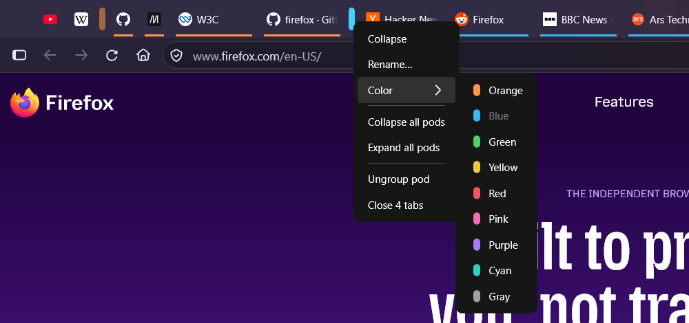
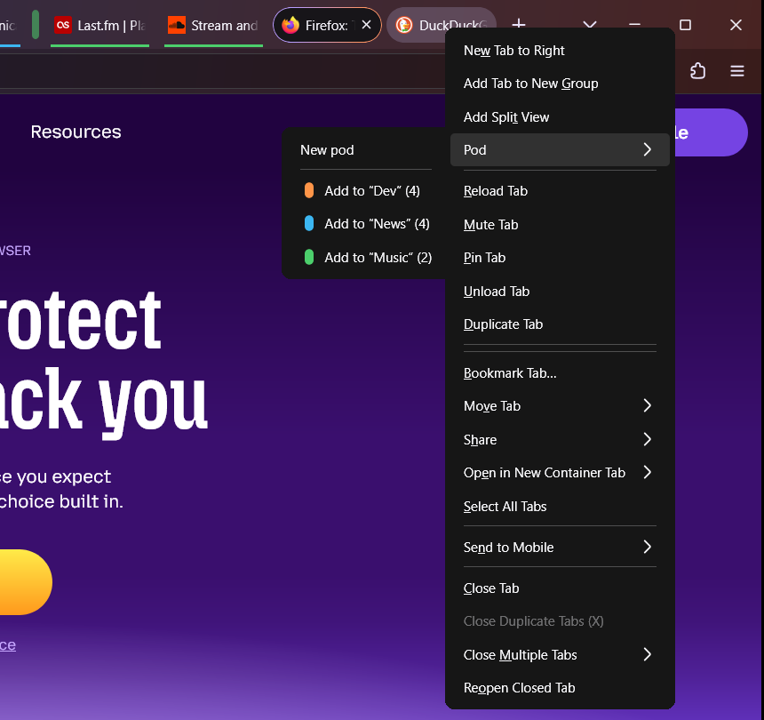

# TabPods

**English** · [Русский](README.ru.md)

**Collapsible tab groups for Firefox that can also hold pinned tabs.**

TabPods puts a small colored capsule in front of each group of tabs. Click the
capsule and the whole group folds away, pinned tabs included; click it again and
the tabs come back.


Firefox's built-in tab groups cannot contain pinned tabs. TabPods can: a pod may
mix pinned and regular tabs, so you can keep, say, your work mail pinned and
still tuck it away together with the rest of your work tabs.

| Expanded | Collapsed |
|---|---|
|  |  |

## Features

- Group any tabs into a pod, **pinned tabs included**.
- Click the capsule to collapse or expand the pod. Collapsed tabs are really
  hidden: they are skipped by Ctrl+Tab, Ctrl+PgDn and "Close Other Tabs".
- Switching to a tab of a collapsed pod (for example from the *List all tabs*
  menu or by reopening it) expands the pod. Collapsing the pod of the current tab switches to another tab.
- Drag and drop: drop a tab right after a capsule or between two tabs of a pod
  and it joins the pod; drag a tab out and it leaves.
- New tabs opened from a tab of a pod are placed after the pod, not inside it.
- 9 colors, optional names (shown in the tooltip).
- Pods, colors and the collapsed state survive a browser restart. Reopening a
  closed tab (Ctrl+Shift+T) puts it back into its pod.
- Interface in English, Russian, Ukrainian, German, French, Spanish, Italian,
  Portuguese (Brazil), Polish, Japanese and Chinese (Simplified and
  Traditional).
- Works with or without [Tab Mix Plus](https://onemen.github.io/tabmixplus-docs/).

## Usage

- **Create a pod:** select one or more tabs (Ctrl+click), right-click a tab →
  **Pod → New pod**.
- **Add tabs:** right-click → **Pod → Add to "…"**, or drag the tabs into the
  pod.
- **Remove tabs:** right-click → **Pod → Remove from pod**, or drag them out.
- **Collapse / expand:** left-click the capsule.
- **Rename, recolor, ungroup, close all tabs of the pod, collapse or expand all
  pods:** right-click the capsule.





## Installation

TabPods is not a regular add-on: Firefox add-ons (WebExtensions) cannot change
the tab strip like this. It is a *userChrome.js* script, a small JavaScript file
that runs inside the Firefox user interface. Firefox needs a script loader for
that, installed once.

### 1. Install a userChrome.js loader

TabPods is tested with the loader from
[onemen/firefox-scripts](https://github.com/onemen/firefox-scripts) (the one
Tab Mix Plus uses). **If you already use Tab Mix Plus, you already have it —
skip to step 2.**

Easiest way, the installer:

1. Download the installer for your system from the
   [latest release](https://github.com/onemen/firefox-scripts/releases/tag/latest):
   `installer_win.exe` (Windows), `installer_mac` (macOS) or `installer_linux` /
   `installer_linux_aarch64` (Linux).
2. Start Firefox, then run the installer. On Windows SmartScreen may say
   "Windows protected your PC" because the installer is unsigned: click
   **More info → Run anyway**.
3. In the tab that opens, keep both components (**Configuration files** and
   **Utils**) selected, click **Install** and restart Firefox when asked.

Or manually: download `fx-folder.zip` and `utils.zip` from the same release,
extract `fx-folder.zip` into the Firefox installation folder (for example
`C:\Program Files\Mozilla Firefox`) and `utils.zip` into the `chrome\utils`
folder of your profile (see below). The
[manual installation guide](https://onemen.github.io/tabmixplus-docs/other/installation/)
has the details.

> The loader runs scripts with full browser privileges, and its configuration
> turns off the add-on signature requirement (Tab Mix Plus needs that). Only put
> scripts you trust into the `chrome` folder.

### 2. Add TabPods

1. Open your profile folder: go to `about:support`, find **Profile Folder** and
   click **Open Folder**.
2. Open the `chrome` folder inside it (create it if there is none).
3. Download [`TabPods.uc.js`](https://raw.githubusercontent.com/buinsky/TabPods/main/TabPods.uc.js)
   (right-click → *Save Link As…*) into that `chrome` folder. The file must be
   named exactly `TabPods.uc.js`.
4. Restart Firefox.

The profile folder should now look like this:

```
<profile>/
└── chrome/
    ├── TabPods.uc.js
    └── utils/          ← the loader from step 1
        ├── userChrome.js
        └── ...
```

Right-click a tab: if you see a **Pod** item, TabPods is working.

### Updating

Replace `TabPods.uc.js` with the new version and restart Firefox.

### Uninstalling

1. **Expand all pods first** (right-click a capsule → *Expand all pods*).
   Collapsed tabs are hidden, and without TabPods nothing would show them again
   (you could still reach them through the *List all tabs* button ⌄ →
   *Hidden tabs*).
2. Delete `TabPods.uc.js` from the `chrome` folder and restart Firefox.

To switch TabPods off without deleting it, add `TabPods.uc.js` to the
`userChromeJS.scriptsDisabled` preference in `about:config` (a comma-separated
list of file names) and restart.

## Language

TabPods uses the language of Firefox and falls back to English. To pick another
language, create the string preference `extensions.tabpods.locale` in
`about:config` with a value such as `en`, `de` or `pt-BR`, then restart.

## Notes and limitations

- Tested with Firefox 158 on Windows 11, with and without Tab Mix Plus. Only the
  horizontal tab strip is supported, not vertical tabs.
- Pods belong to a window. A tab moved to another window leaves its pod.
- Tabs inside Firefox's own tab groups or split views cannot be put into pods.
- A pod with pinned and regular tabs sits on the border between the two. If
  another pod is already there, the pinned part of the new one is shown
  separately, with a capsule of its own; both capsules control the same pod.
- Since this is a userChrome.js script, a big Firefox update can break it.
  Please [open an issue](https://github.com/buinsky/TabPods/issues) if it does.

## License

[MIT](LICENSE)
